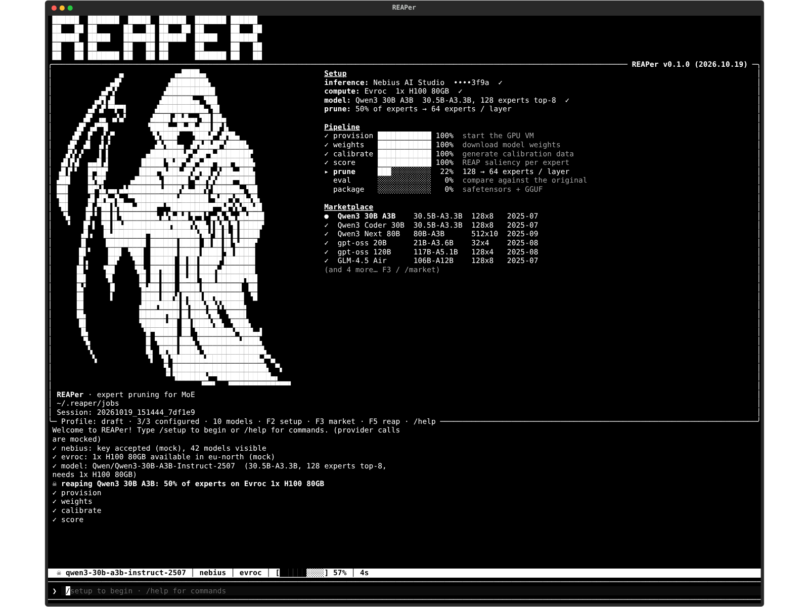

# REAPer

Terminal UI for REAP (router-weighted expert activation pruning) of
mixture-of-experts models: pick an inference provider for calibration data,
a GPU VM provider to run the prune on, and a MoE model from the marketplace,
then reap. Same shape as LobBot's pipeline, but the product is a smaller MoE
with fewer experts per layer instead of a task-specialised GGUF.

**First draft: UI only.** Every provider call and the pipeline run are mocked
in `reaper_tui/mock.py`, and keys live in memory for the session.



## Run

```bash
pip install -e reaper        # from the LobBot checkout (needs textual)
reaper                       # or: python -m reaper_tui
```

| Key / command | What |
|---|---|
| `F2`, `/setup` | inference provider + API key, compute provider + token, GPU |
| `F3`, `/market` | MoE marketplace; enter picks the model |
| `F5`, `/reap` | run the (mock) pipeline |
| `/key nebius <key>` | set the inference key inline |
| `/compute evroc <token> [n]` | set compute inline, `n` = GPU preset 1..5 |
| `/model <name>`, `/prune <pct>` | choose a model, share of experts to drop (default 50) |

The logo grows to the large reaper when the terminal is at least 140x64.

## Pipeline (mocked)

```
provision  start the GPU VM at the compute provider
weights    download the model
calibrate  generate calibration data through the inference provider
score      REAP saliency per expert (router gate weight x expert output norm)
prune      drop the lowest-saliency experts per layer
eval       compare against the original
package    safetensors + GGUF
```

Stages emit LobBot's progress events (`{"stage", "status", "pct", "msg"}`), so
the real VM pipeline can replace the mock without touching the UI.
